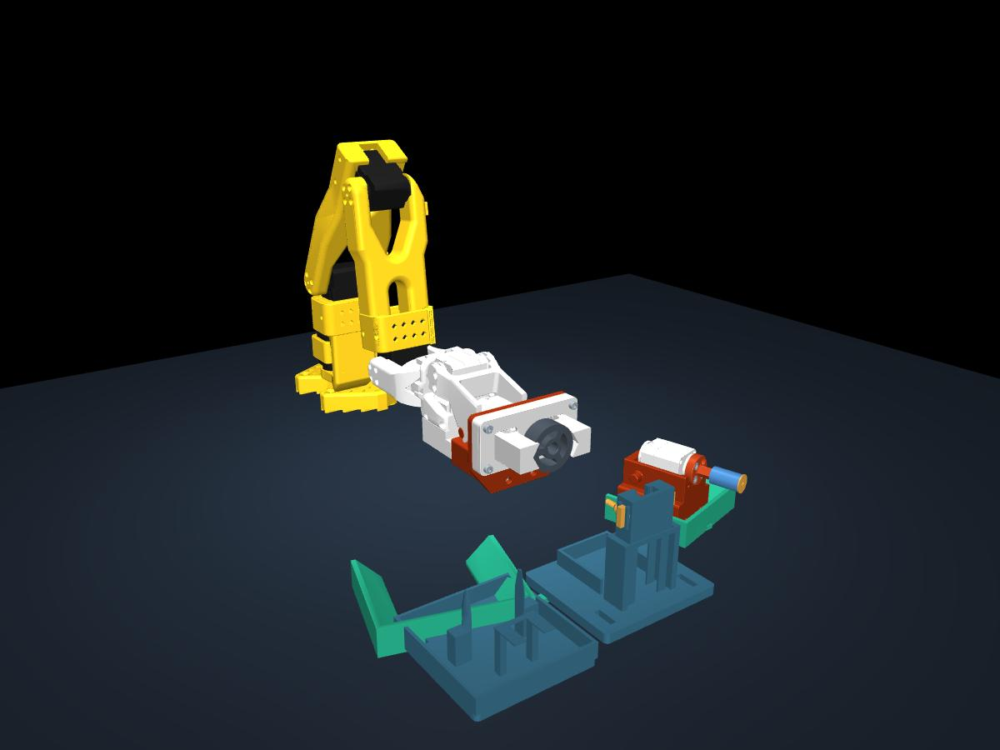

# SO Arm Sim — Mayter

SO-101 arm simulation in MuJoCo, with a force-driven physics workbench and the
original wheel-service animation for reference. Physics mode uses gravity,
contact, friction, motor limits, and feedback-gated tool handling. It reports
failed execution instead of moving objects through obstacles.



## Setup

The existing environment uses Python 3.12. From the repository folder:

```sh
python3.12 -m venv .venv
source .venv/bin/activate
python -m pip install -r requirements.txt
```

The meshes, scene files, CAD sources, and cached motion trajectories are
included, so CAD regeneration is not required to run the simulation.

## Physics mode

Double-click **Open Mayter Sim.command** to open the physics workbench, or run:

```sh
.venv/bin/mjpython run_physics.py
```

**P/Space** runs or pauses, **M** toggles motor power, **F** applies a disturbance,
**R** resets, **C** shows contact forces, and **G** shows collision geometry.
The viewer starts paused. On other desktop platforms, use `python` instead of
`mjpython`.

**Run Physics Cycle.command** attempts the complete reference sequence under
physics. It can stop at an unconfirmed grip, blocked movement, or failed release;
that is a diagnostic result, not a completed service cycle.

```sh
python run_physics.py --headless --scenario hold --seconds 5
python run_physics.py --headless --scenario drop --seconds 2
python run_physics.py --headless --scenario cycle --seconds 180 --csv outputs/cycle.csv
```

The default servo profile assumes the **7.4 V model**. Use `--servo-profile 12v`
for the other published rating. Custom masses, friction, servo control and latch
strength are editable estimates in `physics_sim/parameters.json`.

See [physics assumptions and calibration](docs/physics.md) for the model's scope,
source specifications, diagnostic outputs, and tests. Collision geometry is
included; running physics mode requires only `requirements.txt`.

The [recorded validation](docs/physics-validation.md) shows a stable hold and a
blocked socket-tool pickup. The complete wheel-service cycle has not yet passed
under physics.

## Kinematic reference

On macOS:

```sh
.venv/bin/mjpython full_arm_preview.py
```

Or double-click **Open Kinematic Rehearsal.command** after setting up `.venv`.
The viewer starts paused: **P** plays/pauses, **N** advances to the next stage,
and **R** resets. Playback runs at 4× speed.

On other platforms with a working MuJoCo graphics environment:

```sh
python full_arm_preview.py
```

Generate still previews and run the existing motion checks:

```sh
python full_arm_preview.py --preview
```

Use `--replan` to regenerate the main trajectory after changing the motion.

## Videos

Existing demos are included:

- `Mayter-Single-Fast-Clear-Angle.mp4`: single full cycle with a close camera view.
- `Mayter-20-Parallel-Runs-Clean.mp4`: twenty motion variations shown together.
- Earlier socket-engagement and pickup videos are retained alongside the latest demos.

To render a new video, install FFmpeg and make sure `ffmpeg` is on your PATH
(`brew install ffmpeg` on macOS), then run:

```sh
python render_single_clear_angle.py
```

`render_single_fast.py` and `render_split_views.py` provide other camera layouts.
`render_twenty_runs.py` renders twenty deterministic variations and currently
uses the macOS Arial font path.

## Project files

| Path | Contents |
| --- | --- |
| `run_physics.py`, `physics_sim/` | Force-driven model, servos, contacts, latch and thread dynamics |
| `assets/physics_collision/` | Reproducible collision pieces and CAD mass metadata |
| `docs/physics.md`, `docs/physics-validation.md` | Assumptions, calibration, and measured simulation results |
| `full_arm_preview.py`, `full_arm.xml` | Main wheel-service rehearsal |
| `solve_arm.py` | Inverse kinematics |
| `full_cycle_trajectory.npz` | Cached main trajectory |
| `full_cycle_checks.json` | Most recently saved motion-check report |
| `assets/robotstudio_so101/` | SO-101 robot model, meshes, and upstream license |
| `assets/socket_tool/`, `assets/tire_tool/` | Tool CAD sources and exported meshes |
| `assets/wheel_rev2/`, `assets/wheel_reprints/` | Wheel assembly and repair CAD |
| `assets/sim_two_tool_dock/` | Dock used in the current simulation |
| `build_*.py`, `import_*.py` | Scene construction and CAD import utilities |
| `twenty_runs/` | Cached trajectories, variation data, and contact sheets |

The earlier inspection scripts, scene revisions, and backup scripts are kept
as project history. The reference entry point is `full_arm_preview.py`; physics starts at `run_physics.py`.

For CAD utilities, install the optional dependencies:

```sh
python -m pip install -r requirements-cad.txt
```

## Simulation scope

The original `full_arm_preview.py` wheel-service sequence is a kinematic rehearsal
with prescribed motion and assumed tool, wheel, and nut retention. Physics mode
is documented separately above. Neither mode establishes successful execution
on physical hardware. These scripts do not connect to robot hardware.

The original motion checks cover sampled floor clearance, joint limits, inverse
kinematics error, movement continuity, and the final parked state.

## Included assets

The SO-101 model's upstream documentation and Apache 2.0 license are preserved
in `assets/robotstudio_so101/`. Custom CAD provenance is recorded in the
corresponding asset metadata. No blanket license is assigned to custom work.

Local Python environments, browser profiles, credentials, caches, and runtime
logs are excluded from Git. Existing videos and CAD files are included.
