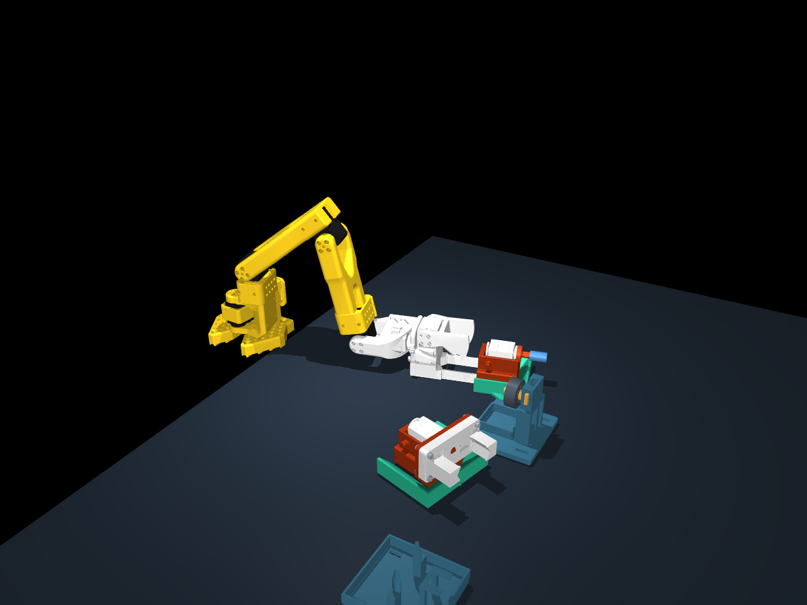

# Physics validation — 2026-10-20

Tested simulation code: `0f2e97a11dc99c642b16d85104f824663b04952b`.
Python 3.12.4, MuJoCo 3.16.0; default 7.4 V follower profile and estimated custom
masses/friction. Collision geometry contains 1,301 convex pieces from 59 source
meshes. The separate release station is offset by 0.15 m as described in
[model assumptions](physics.md).

## Automated checks

`python -m pytest -q`: **17 passed**.

The tests cover gravity-driven free fall, ground support, delayed and bounded
servo effort, sustained-load derating, power-off behavior, and the absence of
runtime pose overrides. Isolated fixtures test contact-gated latch capture,
load-triggered release with power on or off, thread friction dissipation,
resistance below breakaway, and release after finite thread travel. These
isolated mechanism tests do not establish a successful pickup in the full CAD
assembly.

## Scene runs

| Run | Outcome | Simulated duration | Peak sampled contact force | Peak sampled penetration |
| --- | --- | ---: | ---: | ---: |
| [Gravity-loaded hold](validation/hold.json) | Horizon reached; stable | 3.000 s | 1.113 N | 0.112 mm |
| [Motors-off drop](validation/drop.json) | Horizon reached; no numerical warning | 2.000 s | 78.414 N | 2.515 mm |
| [Service-cycle attempt](validation/cycle.json) | Failed tracking gate at socket pickup | 6.861 s | 16.874 N | 0.129 mm |

The hold's maximum joint tracking error was 0.009199 rad
(0.527 degrees), with no arm-motor saturation.
The drop run is a numerical/contact smoke check, not an accuracy qualification:
its approximately 2.5 mm impact penetration remains a limitation of the
estimated compliant contact model and collision approximations.

The service attempt stopped at reference time 2.61 s during
**Slide gripper into socket tool**. The arm exceeded the 0.16 rad tracking threshold
and could not recover within the 3 s wait allowance. The maximum tracking
error was 0.162767 rad; shoulder lift, elbow, and wrist flex
spent significant time at their available torque limits. No tool capture was
confirmed. The remainder of the service cycle has therefore **not been
validated under physics**. This result identifies a problem in the modeled
pickup approach; it does not prove that the real hardware will jam.



## Timestep sensitivity

The same 3 s hold was repeated at 0.5 ms instead of 1 ms. At matching CSV times,
the largest joint-position difference was **0.000112001 rad
(0.006417 degrees)**. The final-position difference was
0.000023936 rad. See the [half-step report](validation/half-step.json).

This supports convergence of the arm's hold position only. Sampled contact peaks
changed from 1.113 N to
5.158 N; the contact sampling interval also halves with the timestep.
Impact and contact-force convergence are not established by this check.

## Reproduce

```sh
python -m pytest -q
python run_physics.py --headless --scenario hold --seconds 3 \
  --report outputs/hold.json --csv outputs/hold.csv
python run_physics.py --headless --scenario drop --seconds 2 \
  --report outputs/drop.json
python run_physics.py --headless --scenario cycle --seconds 180 \
  --report outputs/cycle.json --csv outputs/cycle.csv
```

For the sensitivity run, copy `physics_sim/parameters.json`, change `timestep`
to `0.0005`, and pass its path with `--params`. Keep all other values unchanged.
Exit code 2 from the cycle run is the recorded physical gate failure.

## Next validation work

1. Check the mating CAD surfaces and the pickup approach against the modeled
   contact locations; then develop a compliant pickup that can satisfy the
   existing force and capture checks.
2. Measure tool mass, supply voltage, loaded servo response, latch strength,
   and printed-fastener resistance to replace the estimated parameters.
3. Refine impact compliance and collision geometry, and repeat timestep
   comparisons for contact force and the complete manipulation sequence.
